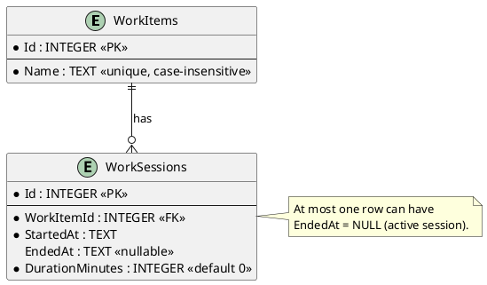

# Database model

The SQLite database stores work items and their sessions. An item's displayed total is the sum of its sessions' `DurationMinutes`; it is not stored separately. Only one session may be active at a time (`EndedAt` is `NULL`).

